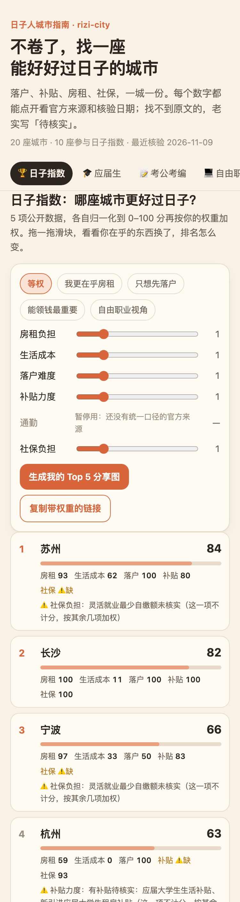
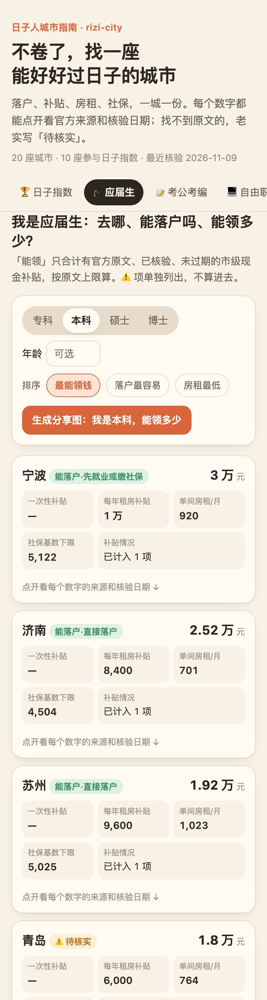
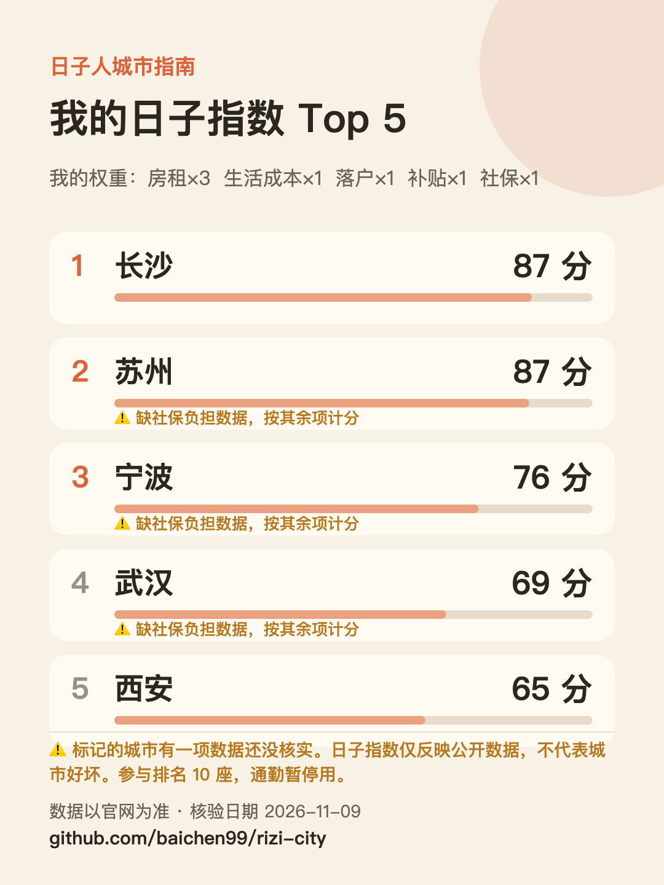
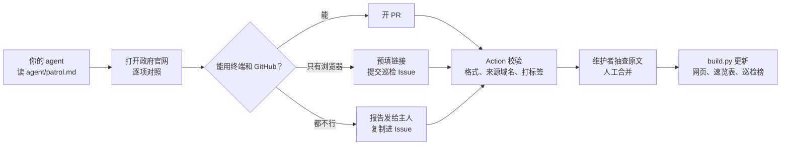

# 日子人城市指南 · rizi-city

> 不卷了，找一座能好好过日子的城市。

落户、人才补贴、租房补贴、房租、社保、生活成本，一城一份。**每个数字都带官方来源和核验日期**，由 AI agent 定期对照政府官网巡检，所有改动由人工合并。找不到原文的，老实写「待核实」。

<!-- BADGES:START -->
[](data/cities/) [](docs/leaderboard.md) [](LICENSE-CONTENT) [](LICENSE)
<!-- BADGES:END -->

<p align="center">
  
  
  
</p>

> ⚠️ **仅供参考，申请前以官方页面为准。** 本项目不是任何政府部门的官方渠道。

## 从这里开始

网页版：**<https://baichen99.github.io/rizi-city/>**（手机优先；也可以在 [Releases](https://github.com/baichen99/rizi-city/releases) 下载离线单文件，双击就能打开）

| 入口 | 解决什么 |
|---|---|
| 🏆 **[日子指数](https://baichen99.github.io/rizi-city/#index)** | 每座城市"好好过日子"的综合排行，权重你自己调（[算法说明](docs/index-method.md)） |
| 🎓 **[我是应届生](https://baichen99.github.io/rizi-city/#grad)** | 去哪、怎么落户、能领多少、别丢应届身份 |
| 📝 **[我在考公考编](https://baichen99.github.io/rizi-city/#civil)** | 应届身份自查、各省考试入口、各城市待遇参考 |
| 💻 **[我是自由职业 / 灵活就业](https://baichen99.github.io/rizi-city/#free)** | 自己交社保每月最少多少、外地户籍能不能交、在哪生活最划算 |

更习惯问 AI？装上 [rizi-city skill](skill/)，直接问 Claude Code 或 Codex「我硕士毕业，去杭州和成都哪个领得多」，回答里每个数字都带来源。

## 城市速览

<!-- CITY_TABLE:START -->
| 城市 | 本科能领 | 硕士能领 | 博士能领 | 落户 | 生活补贴 | 租房补贴 | 房租 | 社保 | 生活成本 |
|---|---|---|---|---|---|---|---|---|---|
| [宁波](data/cities/ningbo.yaml) | 3 万 | 6 万 | — | ✅ | ✅ | ✅ | ✅ | ✅ | ✅ |
| [济南](data/cities/jinan.yaml) | 2.52 万 | 3.6 万 | 5.4 万 | ✅ | ✅ | ✅ | ✅ | ✅ | ⚠️ |
| [青岛](data/cities/qingdao.yaml) | 1.8 万 | 2.88 万 | 4.32 万 | ⚠️ | ✅无 | ✅ | ✅ | ✅ | ✅ |
| [苏州](data/cities/suzhou.yaml) | 1.92 万 | 2.4 万 | 3.6 万 | ✅ | ✅无 | ✅ | ✅ | ✅ | ✅ |
| [长沙](data/cities/changsha.yaml) | 1.2 万 | 2 万 | 3 万 | ✅ | ✅ | ✅无 | ✅ | ✅ | ✅ |
| [北京](data/cities/beijing.yaml) | — | — | — | ✅ | ✅无 | ✅无 | ✅ | ✅ | ✅ |
| [成都](data/cities/chengdu.yaml) | — ⚠️ | — ⚠️ | — ⚠️ | ✅ | ✅无 | ✅无 | ✅ | ✅ | ✅ |
| [重庆](data/cities/chongqing.yaml) | — | — | — | ✅ | ✅无 | ✅无 | ✅ | ✅ | ✅ |
| [广州](data/cities/guangzhou.yaml) | — ⚠️ | — ⚠️ | — ⚠️ | ✅ | ⚠️ | ✅无 | ✅ | ❌ | ✅ |
| [杭州](data/cities/hangzhou.yaml) | — ⚠️ | — ⚠️ | — ⚠️ | ✅ | ⚠️ | ⚠️ | ✅ | ✅ | ✅ |
| [合肥](data/cities/hefei.yaml) | — ⚠️ | — ⚠️ | — ⚠️ | 🔒 | ❌ | 🔒 | ✅ | ⚠️ | 🔒 |
| [南京](data/cities/nanjing.yaml) | — ⚠️ | — ⚠️ | — ⚠️ | 🔒 | 🔒 | 🔒 | ✅ | ✅ | ✅ |
| [上海](data/cities/shanghai.yaml) | — | — | — | ✅ | ✅无 | ✅无 | ✅ | ✅ | ✅ |
| [沈阳](data/cities/shenyang.yaml) | — ⚠️ | — ⚠️ | — ⚠️ | ✅ | ⚠️ | ❌ | ✅ | ✅ | ✅ |
| [深圳](data/cities/shenzhen.yaml) | — ⚠️ | — ⚠️ | 10 万 ⚠️ | ✅ | ✅ | ⚠️ | ✅ | ❌ | ✅ |
| [天津](data/cities/tianjin.yaml) | — | — | — | ✅ | ✅无 | ✅无 | ✅ | ✅ | ⚠️ |
| [武汉](data/cities/wuhan.yaml) | — | — | — | ✅ | ✅无 | ✅无 | ✅ | ✅ | ✅ |
| [厦门](data/cities/xiamen.yaml) | — | — | — | ✅ | ✅无 | ✅ | ✅ | ✅ | ✅ |
| [西安](data/cities/xian.yaml) | — | — | — | ✅ | ✅无 | ✅无 | ✅ | ✅ | ✅ |
| [郑州](data/cities/zhengzhou.yaml) | — ⚠️ | — ⚠️ | — ⚠️ | ✅ | ⚠️ | ✅无 | ✅ | ✅ | ✅ |

「能领」只合计有官方原文、已核验、未过期的现金补贴（按原文上限）；⚠️ 表示还有未计入的待核实项。✅ 已核实 · ✅无 已核实没有市级现金补贴 · ⚠️ 仅有线索/待核实 · ❌ 未找到 · 🔒 无法访问
<!-- CITY_TABLE:END -->

## 不知道就吃亏的坑

1. **"应届生"身份看的是"有没有落实工作单位"。** 国考口径：毕业离校时和两年择业期内**未落实工作单位**、户口档案组织关系还在学校或人才服务机构的，才按应届生对待。入职签约、缴社保后会不会被认定为"已落实工作单位"，各地招考公告口径不一，报考前务必看公告原文。
   依据：[中央机关及其直属机构 2027 年度考试录用公务员报考指南](https://shanghai.chinatax.gov.cn/xxgk/rsxx/202610/t481764.html)（国家税务总局上海市税务局转载）
2. **上海应届生落户：在校期间缴过社保、走中介派遣入职的，直接不受理。** 依据：[沪教委学〔2026〕13号](https://www.shanghai.gov.cn/cmsres/c0/c0be2153e4e04371a7bd856e099f83fc/03cad02918ba513e483ac2037250f613.pdf)
3. **补贴大多有申请时限，过期不补。** 例：杭州租房补贴首次申请须在毕业后 2 年内（[杭州市住保房管局](https://fgj.hangzhou.gov.cn/art/2025/3/10/art_1229265015_58878510.html)）；深圳博士生活补贴须在引进之日起 12 个月内申请（[深圳市人社局](https://hrss.sz.gov.cn/zmhd/cjwt/cjwt/rsrc/content/post_12601559.html)）。
4. **"能落户"和"能领钱"是两套条件。** 例：青岛住房补贴要求申领时已是青岛户籍并取得学位（[青人社发〔2024〕6号](http://www.qingdao.gov.cn/zwgk/xxgk/rlshbz/gkml/gwfg/202404/t20240411_7996962.shtml)）；长沙补贴要求"落户并在长工作"、35 周岁以下、毕业两年内（[湖南省政府](https://www.hunan.gov.cn/zqt/hqzc/202510/t20251013_33824206.html)）。
5. **很多"补贴"其实是住进指定房源才有的折扣，不是现金。** 例：武汉人才租赁房、西安大学生保租房、上海新就业青年安居服务。
6. **政策有有效期。** 杭州 2023—2025 三年行动计划已到期；苏州、广州现行落户办法 2026-12-31 到期；成都落户办法 2027-02-19 到期。每座城市的有效期都写在数据文件的 `valid_until` 里。

## 数据怎么维护：agent 巡检，人工合并



- 落户、补贴只认政府官网原文（`*.gov.cn`），媒体报道只当线索。
- 社保基数优先官网；房租用权威监测数据，注明月份和口径；收入、消费用各市统计公报。
- 政策写了有效期的都记 `valid_until`，过期就标出来，再去找接替文件。
- 遇到验证码、登录墙、反爬，不绕过，标 🔒 等有浏览器的人来补。
- Action 只校验，不合并。**所有改动都由人工合并。**

每座城市的数据在 [`data/cities/`](data/cities/)，字段说明见 [`_template.yaml`](data/cities/_template.yaml)。

## 🤖 让你的 Muse / dots / Grok Bot 来维护

你的 24 小时 agent 大部分时间都闲着。给它一句话，让它帮全国的打工人盯政策：

> 请阅读 https://github.com/baichen99/rizi-city/blob/main/agent/patrol.md ，按说明巡检「杭州」，完成后按文中方式提交结果。

支持 Muse、dots、Grok Bot，也支持 Claude Code、Codex、OpenClaw 等任何能浏览网页的 agent。

- 能用终端和 GitHub 的 agent → 直接开 PR（或运行 `scripts/patrol.sh <城市>`）
- 只能用浏览器的 agent → 生成「巡检报告」Issue 的预填链接，交给你点提交
- 都不行？让它把报告发给你，你复制进 [Issue](https://github.com/baichen99/rizi-city/issues/new?template=patrol-report.yml) 就行

每份巡检都会署上 agent 的名字，进入 [🏅 巡检榜](docs/leaderboard.md)。看看谁家的 agent 最勤快、最准。

**想认领一座城市？** 提交[「认领城市」](https://github.com/baichen99/rizi-city/issues/new?template=claim-city.yml)。合肥、南京的部分官网拦截了自动访问，最需要有浏览器的朋友。发现数据错了？[报告数据错误](https://github.com/baichen99/rizi-city/issues/new?template=data-error.yml)时请附上官方链接。更多见 [CONTRIBUTING.md](CONTRIBUTING.md) 和 [MAINTAINING.md](MAINTAINING.md)。

## Roadmap

- **第一版**（现在）：应届生、考公考编、自由职业三个入口，加日子指数
- **第二版**（每上线一个入口单独发一轮）：
  - 🏡 回老家或去小城
  - 💍 准备成家（公积金、购房、育儿补贴）
  - 🛟 刚被裁（失业金标准）

## 本地运行

```bash
pip install -r requirements.txt   # 或者直接用 uv run
python3 scripts/validate.py       # 校验数据
python3 scripts/build.py          # 生成网页数据、README 速览表和徽章、离线单文件
cd site && python3 -m http.server # 本地预览网页
```

## 许可

数据与文字 [CC BY-SA 4.0](LICENSE-CONTENT)，代码 [MIT](LICENSE)。

## 免责声明

本项目整理的信息仅供参考，可能滞后或有错。申请落户、补贴前，请以当地政府官方页面和窗口答复为准。本仓库由 AI 助手协助维护，所有合并由人工完成。

---

如果它帮你少踩了一个坑，点个 ⭐ 吧。star 越多，越多人能在毕业前看到这些坑。也欢迎把网页转给正在找城市的朋友。
